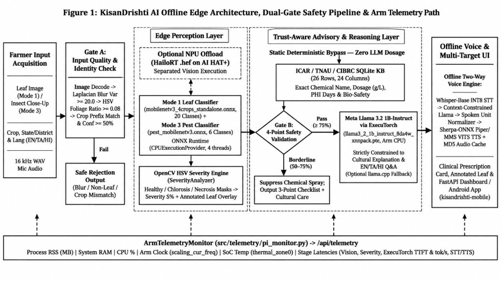
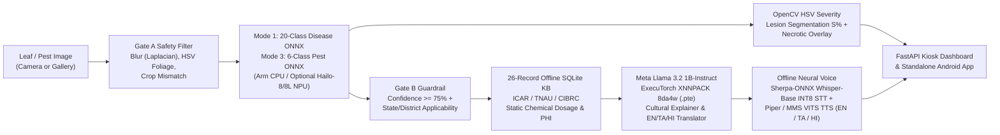
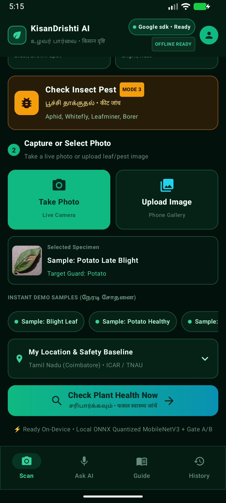
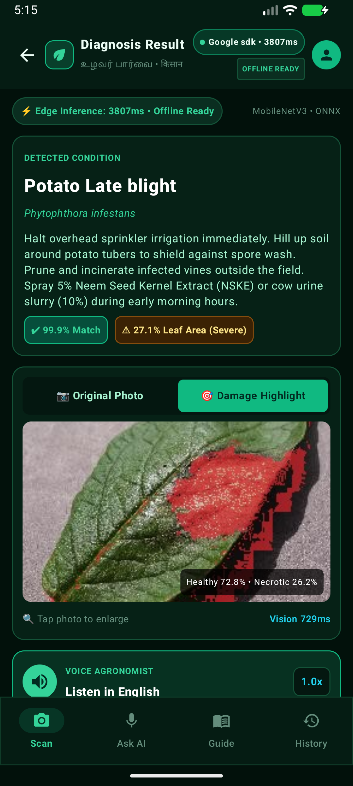
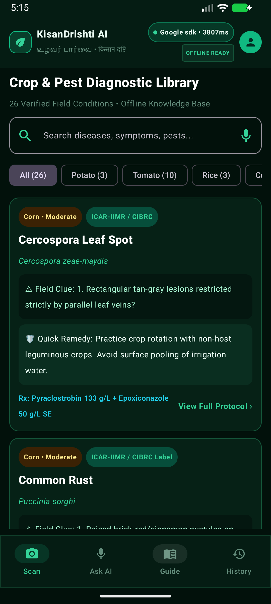
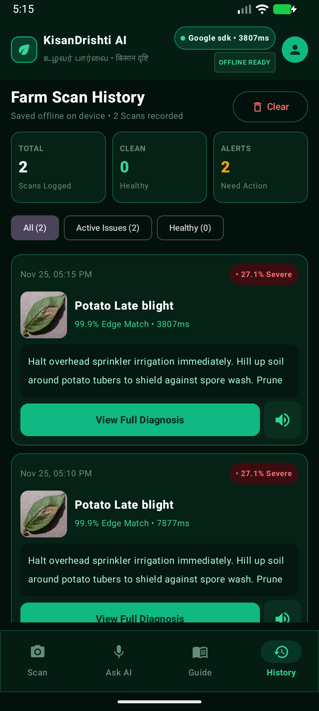
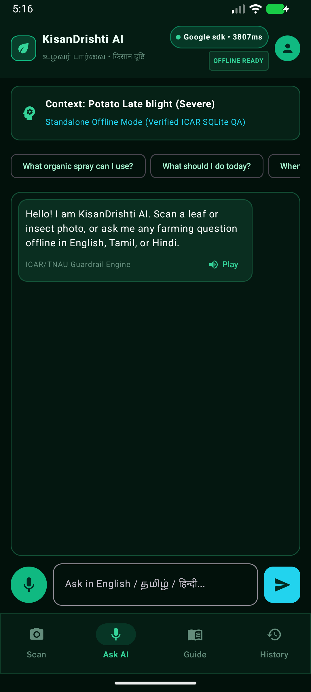

# KisanDrishti AI (உழவர் பார்வை / किसान दृष्टि)

**Offline Multimodal Crop Disease & Pest Diagnostics, Lesion Severity Quantification, and ExecuTorch Llama 3.2 Trilingual Advisory on Arm Edge (Raspberry Pi 5 + Android)**

[](#architecture)
[](#architecture)
[](#measured-evaluation-results)
[](LICENSE)

KisanDrishti AI delivers zero-internet, clinical-grade agricultural triage across **4 staple crops (20 disease classes)** and **6 major insect pests**, pairing edge vision with **ICAR / TNAU / CIBRC** safety guardrails, **Meta Llama 3.2 1B-Instruct** on **ExecuTorch**, and **offline Tamil / Hindi / English speech**.

---

## Key Project Links

- **GitHub Repository:** https://github.com/AkshayaSrelekaPS/kisandrishti-ai
- **Android Mobile App APK (`v1.0-mobile`):** [Download KisanDrishti-AI.apk (85.29 MB)](https://github.com/AkshayaSrelekaPS/kisandrishti-ai/releases/download/v1.0-mobile/KisanDrishti-AI.apk)
- **ExecuTorch Llama 3.2 Edge Weights (`v1.0-models`):** [Download `llama3_2_1b_instruct_8da4w_xnnpack.pte` (765.32 MB)](https://github.com/AkshayaSrelekaPS/kisandrishti-ai/releases/download/v1.0-models/llama3_2_1b_instruct_8da4w_xnnpack.pte)
- **Architecture & Optimization Technical Docs:** [docs/ARCHITECTURE.md](docs/ARCHITECTURE.md)

---

## System Architecture





### Strict Runtime Separation
- **Vision Pipeline:** Runs quantized/standalone `MobileNetV3-Small` via **ONNX Runtime** on Arm Cortex-A76 CPU (or optional **HailoRT** `.hef` on Raspberry Pi AI HAT+ NPU — see [deploy/HAILO_NPU.md](deploy/HAILO_NPU.md)).
- **Reasoning Pipeline:** Runs **Meta Llama 3.2 1B-Instruct (`8da4w` XNNPACK `.pte`)** via **ExecuTorch** strictly on Arm CPU (`llama.cpp` GGUF supported as optional fallback).
- **Zero-Hallucination Clinical Guardrail:** Llama 3.2 acts **strictly** as a cultural explainer and Tamil/Hindi/English translator. Verified chemical formulations, water-dilution dosages, Pre-Harvest Intervals (PHI), and pollinator protections are rendered statically from `data/icar_agronomic_kb.sqlite` after passing Gate B (`confidence >= 75%`).

---

## Supported Crops, Diseases & Pests

| Mode | Scope | Classes |
|---|---|---|
| **Mode 1: Leaf Disease + Severity** | Potato (3), Tomato (10), Rice (3), Corn/Maize (4) | **20 classes** (`models/mobilenetv3_4crops_standalone.onnx`) |
| **Mode 3: Insect Pest Screening** | Aphid, Brown Planthopper, Corn Borer, Leafminer, Rice Leaf Roller, Whitefly | **6 classes** (`models/pest_mobilenetv3.onnx`) |
| **Knowledge Base & Guardrails** | Curated ICAR / TNAU / CIBRC treatments with EN / TA / HI scripts & regional validation | **26 clinical records** (`data/icar_agronomic_kb.sqlite`) |

---

## Measured Evaluation Results

Measured across held-out validation splits (`models/evaluation_report_20classes.json` & `models/pest_classes.json`):

| Metric | Measured Value | Notes |
|---|---|---|
| **20-Class Overall Accuracy** | **99.79%** | `4,855` held-out leaf images |
| **20-Class Macro-F1** | **0.9975** | Balanced precision/recall across all 4 crops |
| **Gate A Crop Accuracy** | **99.94%** | Prevents cross-crop false diagnoses |
| **Mean / P95 ONNX Vision Latency** | **1.50 ms / 1.71 ms** | Single-frame `224x224` `mobilenetv3_4crops_standalone.onnx` |
| **Confidence Calibration (ECE)** | **0.001** | Temperature scaled (`T = 1.05`) |
| **High-Confidence Band (`>= 75%`)** | **99.83% accuracy** | `4,848 / 4,855` images pass Gate B cleanly |
| **Mode 3 Pest Classifier (6 Classes)** | **71.33% val accuracy** | Trained on IP102 field insect close-ups |

Confusion matrices: [20-Class Evaluation](models/confusion_matrix_20classes_eval.png) | [4-Crop Matrix](models/confusion_matrix_4crops.png)

---

## Two Deployment Targets

### 1. Edge Kiosk & Web Dashboard (Windows / Linux / Raspberry Pi 5)
Serves the complete offline dashboard (`http://localhost:8000` locally or `https://<device-ip>:8443` over LAN) with live hardware telemetry, Mode 1 & Mode 3 scanning, Severity Overlay, ExecuTorch Llama 3.2 reasoning, 26-condition library, and two-way Whisper + Piper Voice Q&A.

#### A. Run on Windows (PowerShell, Python >= 3.11)
```powershell
git clone https://github.com/AkshayaSrelekaPS/kisandrishti-ai.git
cd kisandrishti-ai

python -m venv .venv
.\.venv\Scripts\Activate.ps1
pip install --upgrade pip
pip install -r requirements.txt requests

python setup_llm_model.py
python -m src.reasoning.icar_db
python setup_offline_voice_models.py
python precache_voices.py

# Optional verification & latency benchmark
python test_pipeline.py
python test_voice_assistant.py
python benchmark_suite.py

# Start Dashboard -> open http://localhost:8000
python -m uvicorn src.web_app:app --host 0.0.0.0 --port 8000
```

#### B. Run on Linux (Ubuntu / Debian x86_64 or Arm64, Python >= 3.11)
```bash
git clone https://github.com/AkshayaSrelekaPS/kisandrishti-ai.git
cd kisandrishti-ai

sudo apt update && sudo apt install -y python3-venv python3-opencv sqlite3 espeak-ng openssl
python3 -m venv --system-site-packages .venv
source .venv/bin/activate
pip install --upgrade pip
pip install -r requirements.txt requests

python setup_llm_model.py
python -m src.reasoning.icar_db
python setup_offline_voice_models.py
python precache_voices.py

# Optional verification & latency benchmark
python test_pipeline.py
python test_voice_assistant.py
python benchmark_suite.py

# Start Dashboard -> open http://localhost:8000
python -m uvicorn src.web_app:app --host 0.0.0.0 --port 8000
```

#### C. Run on Raspberry Pi 5 (Automated Setup & Systemd Kiosk)
```bash
git clone https://github.com/AkshayaSrelekaPS/kisandrishti-ai.git
cd kisandrishti-ai
chmod +x deploy/install_pi5.sh deploy/run_kiosk.sh deploy/verify_pi5.sh
./deploy/install_pi5.sh
./deploy/verify_pi5.sh

# Local kiosk (HTTP -> http://localhost:8000)
./deploy/run_kiosk.sh

# LAN access with browser microphone & mobile sync (HTTPS -> https://<pi-ip>:8443)
./deploy/run_kiosk.sh --https
```

> **Note on datasets for CLI checks:** Raw training sets (`data/crops/`, `data/pests/`) are excluded by `.gitignore`. Run `python fetch_core_datasets.py` before running `test_mode3_pest.py` or `evaluate_20classes.py` standalone.

### 2. Standalone Offline Android Mobile App (`kisandrishti-mobile/`)
A native **Kotlin + Jetpack Compose** Android app featuring on-device ONNX Runtime inference, HSV lesion Damage Highlight overlay, CameraX live scanner + Gallery upload, SQLite offline 26-condition library, Android EN/TA/HI TTS & STT, persistent scan history, and optional Wi-Fi sync to a Raspberry Pi 5 ExecuTorch server.

| Scan Home | Diagnosis + Damage Highlight | Diagnostic Guide (26) | Farm Scan History | Multilingual Ask AI |
|---|---|---|---|---|
|  |  |  |  |  |

Install directly on Android via `v1.0-mobile` release APK or build from `kisandrishti-mobile/` in Android Studio.

---

## Repository Structure

```text
kisandrishti-ai/
├── src/
│   ├── web_app.py                   # FastAPI kiosk server & unified 4-tab web dashboard
│   ├── diagnose.py                  # Unified Mode 1 + Gate A/B + Mode 3 pipeline
│   ├── vision/                      # HSV lesion analyzer, Mode 3 pest detector, HailoRT NPU hook
│   ├── reasoning/icar_db.py         # 26-record ICAR/TNAU/CIBRC SQLite knowledge base builder
│   ├── advisory/agronomist_engine.py# ExecuTorch Meta Llama 3.2 1B (.pte) + llama.cpp fallback
│   ├── audio/                       # Sherpa-ONNX Whisper-Base INT8 STT & Piper/MMS VITS TTS
│   └── telemetry/pi_monitor.py      # Live Arm CPU frequency, RAM RSS & SoC thermal telemetry
├── deploy/                          # Pi 5 installer, systemd kiosk, verifier, Hailo guide, USB bundler
├── models/                          # Standalone ONNX models, class maps, tokenizer, evaluation reports
├── data/                            # icar_agronomic_kb.sqlite & sample test leaf images
├── kisandrishti-mobile/             # Complete standalone Android Studio (Jetpack Compose + ONNX) project
└── docs/                            # Technical architecture, optimization notes & UI screenshots
```
